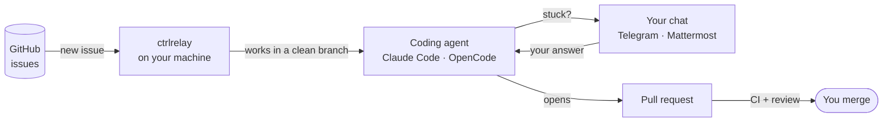

# ctrlrelay

[](https://opensource.org/licenses/Apache-2.0)
[](https://pypi.org/project/ctrlrelay/)
[](https://pypi.org/project/ctrlrelay/)
[](https://github.com/AInvirion/ctrlrelay/actions/workflows/test.yml)

**Assign an issue. Get a reviewed pull request. Answer questions from your phone.**

ctrlrelay turns the coding agent you already use into a teammate that works
your GitHub backlog in the background. It picks up issues, writes the code in
a clean branch, opens a pull request, waits for CI, gets the change reviewed,
and pings you on **Telegram** or **Mattermost** only when it truly needs you.

It runs on your own machine. Your code, your credentials, your agent
subscription. No hosted service in the middle.

**[Documentation](https://ainvirion.github.io/ctrlrelay/)** ·
**[Get started](https://ainvirion.github.io/ctrlrelay/getting-started/)** ·
**[Why ctrlrelay](https://ainvirion.github.io/ctrlrelay/#why-ctrlrelay)**

## Why ctrlrelay

Coding agents are great when you sit and watch them. ctrlrelay is for the
work you don't want to sit and watch.

- **Your backlog is the to-do list.** No new tool to learn. Assign an issue
  (or add a label) and the work starts. Teammates you allow can hand it work
  the same way. The result is a normal pull request
  your team already knows how to review.
- **Runs where your code already lives.** ctrlrelay is a small program on your
  laptop or server — not a cloud service. Nothing leaves your machine except
  the calls your agent and GitHub already make. No per-seat platform fee on
  top of the agent you already pay for.
- **It asks instead of guessing.** When the agent is stuck, you get the
  question in chat. You reply from your phone and the *same* session picks up
  where it stopped.
- **Safe by default.** Every issue gets its own isolated copy of the repo.
  One job per repo at a time. Optional Linux sandbox that hides your secrets
  from the agent. Nothing merges without your rules allowing it.
- **Done means done.** It waits for CI, fixes failing checks, and posts an
  independent review on the pull request — so what reaches you is ready to
  read, not a first draft.
- **Pick your agent per repo.** Claude Code or OpenCode today, plus simple
  non-interactive CLIs enrolled through a local plugin manifest. Choose the
  default per repo; a future control plane can select from the agents you allow.
- **Grows with you.** Start on one laptop. Add more machines later; they share
  the work without stepping on each other.
- **Open source.** Apache 2.0. Read every line of what runs on your machine.

## What it does

- **Issues → pull requests.** Watches every repo you choose and works each new
  issue end to end.
- **Questions in your chat.** Telegram (a private bot) or Mattermost (a channel
  on your own server).
- **Automatic review.** Every agent pull request gets a second-opinion review
  comment before you look at it.
- **Daily security sweep.** Reviews Dependabot alerts and pull requests across
  your repos every morning.
- **Status page.** See what each agent is doing, what is waiting, and what
  needs you — at a glance.
- **Many machines, one account.** Spread work across machines, with one chat
  and one status page.
- **Settings follow you.** Optional sync of your agent setup across machines
  through a private GitHub repo.

## How it works



1. **You assign an issue** to yourself, or add a label you pick. Teammates
   on your `allowed_accounts` list can do the same.
2. **ctrlrelay starts the agent** in a fresh, isolated copy of the repo.
3. **If the agent has a question**, it lands in your chat. Your reply goes
   straight back to the same session.
4. **A pull request opens.** ctrlrelay waits for CI, fixes what fails, and
   posts a review.
5. **You merge** — or ask for changes, like with any teammate.

## Quick start

```bash
pipx install ctrlrelay
ctrlrelay setup          # finds your repos and writes your config
ctrlrelay poller start   # starts working assigned issues
```

You need Python 3.12+, the GitHub CLI, and a coding agent CLI. The
**[getting started guide](https://ainvirion.github.io/ctrlrelay/getting-started/)**
covers prerequisites, chat setup and running it as a background service.

## Documentation

Everything lives at **[ainvirion.github.io/ctrlrelay](https://ainvirion.github.io/ctrlrelay/)**:

- [Getting started](https://ainvirion.github.io/ctrlrelay/getting-started/) — install and first run
- [Chat bridge](https://ainvirion.github.io/ctrlrelay/bridge/) — set up Telegram or Mattermost
- [Configuration](https://ainvirion.github.io/ctrlrelay/configuration/) — every setting
- [Operations](https://ainvirion.github.io/ctrlrelay/operations/) — background services, status page, several machines
- [CLI reference](https://ainvirion.github.io/ctrlrelay/cli/) — every command

## Contributing

Contributions are welcome. Read the [contributing guide](CONTRIBUTING.md) and
the [code of conduct](CODE_OF_CONDUCT.md). First-time contributors sign a
one-time Contributor Assignment Agreement in the pull request.

## Security

Found a vulnerability? Please follow the [security policy](SECURITY.md) and open
a private advisory — not a public issue.

## License

Apache License 2.0 — see [LICENSE](LICENSE).

Copyright (c) 2026 AInvirion LLC. All Rights Reserved.
