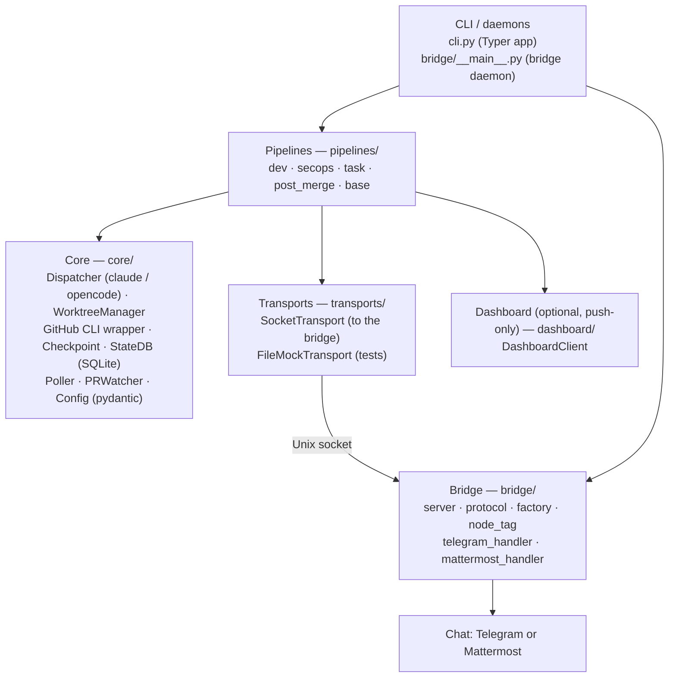
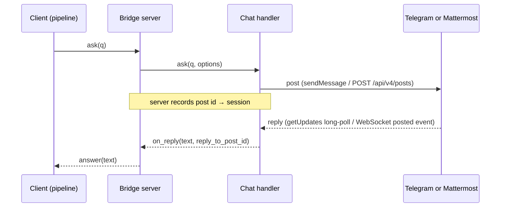

# Architecture

This page is for people working _on_ ctrlrelay, not just _with_ it. For an
operator-level view of the BLOCKED protocol see
[Feedback loop]({{ '/feedback-loop/' | relative_url }}).

## Layered overview



The CLI is a thin shell over async functions in `pipelines/` and `core/`. The
bridge is a separate daemon that pipelines reach over a Unix socket — it is
deliberately decoupled so it can be restarted without affecting in-flight
pipeline work.

## Dispatcher ↔ agent interaction

[`src/ctrlrelay/core/dispatcher.py`](https://github.com/AInvirion/ctrlrelay/blob/main/src/ctrlrelay/core/dispatcher.py)
is the only place ctrlrelay calls out to a coding agent. It has two adapters
with the same async `spawn_session` shape, so pipelines stay agent-agnostic:
`ClaudeDispatcher` (Claude Code) and `OpenCodeDispatcher` (OpenCode).
`make_repo_agent_dispatcher` picks one per repo: `agent.type` is the default,
`repos[].agent_type` overrides it for a single repo.

- **Spawn shape:** Claude Code runs
  `claude -p <prompt> --output-format stream-json --verbose --dangerously-skip-permissions [--resume <id>]`;
  OpenCode runs `opencode run ... --format json --dangerously-skip-permissions [--session <id>]`.
- **Working directory:** the session's worktree (so file edits land on the
  right branch).
- **Environment additions:** `CTRLRELAY_SESSION_ID` and `CTRLRELAY_STATE_FILE`
  are the only contract between dispatcher and child. Anything else the agent
  needs (issue body, PR rules, etc.) goes into the prompt.
- **Credentials (#219):** every spawn says whether it gets GitHub access
  (`spawn_session(..., github_access=...)`, no default). dev and task spawn
  without it: GitHub tokens, `gh`'s login, git credential helpers, SSH and
  the desktop keyring are cut off (`core/agent_env.py`), and ctrlrelay
  pushes the branch, opens the PR or posts the report itself afterwards
  (`core/publish.py`, `WorktreeManager.push_run_branch`). secops still
  spawns with access. See
  [What the agent can reach](configuration.md#what-the-agent-can-reach-219).
- **Result:** `SessionResult(session_id, exit_code, state, stdout, stderr,
  agent_session_id)`. `session_id` is our composite orchestrator id;
  `agent_session_id` is the agent's own session id, parsed from its JSON
  stdout and the value its resume flag actually expects. `state` is the parsed
  `CheckpointState` if a state file was written, else `None`. The wrapper
  exposes `.success`, `.blocked`, `.failed` properties for pattern-matching
  pipelines.
- **Resume:** `resume_session_id` translates to `--resume <id>` (Claude
  Code) or `--session <id>` (OpenCode). Pipelines look up the agent's own id
  (persisted as `sessions.agent_session_id` by the prior spawn) and pass it
  through — newer `claude` CLI builds reject non-UUID values. If state_db
  has no id (session predates capture or stdout wasn't JSON), the spawn falls back to a fresh session rather than
  hard-failing.

The dispatcher does NOT proxy or wrap the agent session — it shells out the
same way you'd shell out to `gh` or `git`. This is deliberate.

## State DB shape

Schema in
[`src/ctrlrelay/core/state.py`](https://github.com/AInvirion/ctrlrelay/blob/main/src/ctrlrelay/core/state.py).
SQLite, single file at `paths.state_db`.

| Table | Columns | Notes |
|---|---|---|
| `sessions` | `id`, `pipeline`, `repo`, `issue_number`, `worktree_path`, `status`, `blocked_question`, `started_at`, `ended_at`, `claude_exit_code`, `summary`, `agent_session_id`, `output_tail` | Indexed on `repo` and `status`. One row per pipeline run. `agent_session_id` stores the agent's own session id for resume; `claude_exit_code` holds the worker's exit code whichever backend ran; `output_tail` is a scrubbed, capped tail of its output (#204). |
| `repo_locks` | `repo` (PK), `session_id`, `acquired_at` | Acquired with `acquire_lock`, released in the pipeline's `finally`. |
| `github_cursor` | `repo`, `last_checked_at`, `last_seen_issue_update` | Bounds GitHub API calls in the poller. |
| `pending_resumes` | `session_id` (PK), `pipeline`, `repo`, `question`, `created_at`, `answer`, `answered_at`, `resumed_at`, `expired_at`, `expired_reason`, `held_until`, `posted`, `last_answered_at` | One row per BLOCKED session awaiting an answer, whichever chat it was asked on. An answer arriving after the in-session wait lands here and the poller's sweeper drives the resume. |
| `pr_watches` | `repo`, `pr_number` (PK pair), `session_id`, `issue_number`, `pr_url`, `started_at`, `cleanup_phase` | In-flight post-merge watchers, rehydrated on poller start. |
| `automation_decisions` | `id`, `repo`, `operation`, `policy`, `item_id`, `decision`, `decided_by`, `decided_at`, `context` | Audit trail for `ask`-policy decisions. |
| `dispatch_health` | single row: `consecutive_failures`, `alerted_at`, `alert_claim_token`, `alert_delivered_at`, `last_failure_at`, `last_success_at` | Whether the relay can still run a worker at all (#204). |
| `relay_pushes` | `id`, `repo`, `branch`, `session_id`, `sha`, `pushed_at` | Every branch head ctrlrelay pushed for an agent (#219); the push lease is taken from here. |
| `events` | `id`, `ts`, `kind`, `repo`, `issue_number`, `session_id`, `detail` | Feed for the status page, written best-effort. |
| `telegram_pending` | `request_id`, `session_id`, `question`, `asked_at`, `answered_at`, `answer` | Legacy: still created by the schema, but no code reads or writes it. Outstanding questions live in `pending_resumes`. |

Methods on `StateDB`: `acquire_lock`, `release_lock`, `get_lock_holder`,
`list_locks`, `set_agent_session_id`, `get_agent_session_id`, plus raw
`execute` / `commit`. The pipeline code uses raw SQL for the `sessions`
table on purpose — kept thin and grep-able.

## Worktree lifecycle

`WorktreeManager` (in
[`src/ctrlrelay/core/worktree.py`](https://github.com/AInvirion/ctrlrelay/blob/main/src/ctrlrelay/core/worktree.py))
is a thin wrapper over `git worktree`. Conventions:

- **Bare repo path:** `<paths.bare_repos>/<owner>-<repo>.git`. Cloned on first
  use, fetched on each subsequent use.
- **Worktree path:** `<paths.worktrees>/<owner>-<repo>-<session_id>`.
- **Branch:** for the dev pipeline, derived from `dev_branch_template` with
  `{n}` → issue number. Default `fix/issue-{n}`.

Lifecycle in `run_dev_issue`:

```
ensure_bare_repo(repo)
branch_preexisted = await branch_exists_locally(repo, branch)
worktree_path = create_worktree_with_new_branch(repo, session_id, branch)
... agent session runs ...
on DONE:    remove_worktree (keep branch — open PR refs it)
on BLOCKED: keep both (operator may resume)
on FAILED:  remove_worktree
            if not branch_preexisted and not on remote: delete_branch
```

The "preexisted" guard prevents a retry from clobbering a branch that already
holds an open PR from a previous successful session.

## PR verifier and post-merge

After a `DONE`-with-`pr_url` checkpoint, the dev pipeline runs
[`PRVerifier`](https://github.com/AInvirion/ctrlrelay/blob/main/src/ctrlrelay/core/pr_verifier.py)
to confirm the PR is mergeable and CI is green. If not, it builds a fix prompt
(merge conflicts → "rebase and resolve", failing checks → "investigate and
fix"), resumes the same agent session with that prompt, and re-verifies. Up
to `DEFAULT_MAX_FIX_ATTEMPTS` (3) attempts.

`PRWatcher` (in
[`src/ctrlrelay/core/pr_watcher.py`](https://github.com/AInvirion/ctrlrelay/blob/main/src/ctrlrelay/core/pr_watcher.py))
polls a PR for merge status; the post-merge handler in
[`src/ctrlrelay/pipelines/post_merge.py`](https://github.com/AInvirion/ctrlrelay/blob/main/src/ctrlrelay/pipelines/post_merge.py)
closes the originating issue and notifies the operator once the PR lands.
The poller starts one `pr_watch_task` per PR the dev pipeline hands off, and
persists it in `pr_watches` so a poller restart resumes the watch.

## Bridge architecture

The bridge daemon (`ctrlrelay/bridge/server.py`) listens on a Unix socket
(mode `0o600` — owner-only). It speaks newline-delimited JSON, defined in
`bridge/protocol.py`:

The bridge builds exactly one chat handler from `transport.type`
(`bridge/factory.py`): `TelegramHandler` or `MattermostHandler`. The server
knows only the handler interface, so the flow is the same for both:



The handler reports the post the reply points at — Telegram's
`reply_to_message_id`, or Mattermost's thread `root_id`. Matching reply →
pending question:

1. The reply points at a live pending question — route to that question.
   This is the only route that is right when several are outstanding.
2. The reply points at a question that is no longer live (its ask timed
   out, or the bridge restarted) — hand it to the orphan router, which
   attaches the answer to that session's `pending_resumes` row.
3. A fresh message with exactly one question outstanding — route there.
4. A fresh message with several outstanding — refuse, and tell the operator
   to reply to the question they mean. There is no FIFO fallback.

When several machines share one Mattermost bot and channel
(`transport.mattermost.shared: true`), each machine prefixes its posts with
`[<node>]` and ignores replies to other machines' posts (`bridge/node_tag.py`).

Multiple in-flight asks are supported. The bridge retains the original
socket for each ask so the answer routes back to the correct caller.

Bridge restart safety: pending in-memory state is lost on bridge restart.
Pipelines waiting on `transport.ask` stop waiting and persist the session as
`BLOCKED` with a `pending_resumes` row; a later answer still drives the
resume through the sweeper. Restart the bridge **before** restarting the
poller to minimise this window.

## Why this shape

A few decisions worth flagging:

- **Local-first, file-based protocol.** Everything between ctrlrelay and the
  agent is a file under the worktree. No long-lived shared memory, no socket
  contract with the agent. Survives orchestrator restart trivially.
- **Subprocess-not-library.** `claude` or `opencode` is invoked as a
  subprocess. ctrlrelay has no Python coupling to either agent's internals — it exchanges a prompt
  in and a JSON file out. Versioning is decoupled.
- **Per-repo serial, parallel across repos.** Repo locks in SQLite enforce
  this. A failed lock acquisition fails the session immediately rather than
  queueing.
- **No background event loop.** Each CLI command spins up its own
  `asyncio.run(...)`. The poller and bridge each own one event loop while they
  run. Simpler to reason about than a long-lived shared loop.
- **Bridge as separate process.** Restartable independent of pipelines. The
  cost is the small in-memory pending-asks state that does not survive a
  bridge restart.

## Where to read next

- [`src/ctrlrelay/core/config.py`](https://github.com/AInvirion/ctrlrelay/blob/main/src/ctrlrelay/core/config.py)
  — pydantic schema, the source of truth for the YAML.
- [`src/ctrlrelay/pipelines/dev.py`](https://github.com/AInvirion/ctrlrelay/blob/main/src/ctrlrelay/pipelines/dev.py)
  — full dev-pipeline orchestration including BLOCKED loop and PR-fix loop.
- [`src/ctrlrelay/core/dispatcher.py`](https://github.com/AInvirion/ctrlrelay/blob/main/src/ctrlrelay/core/dispatcher.py)
  — the only place we call `claude` or `opencode`.
- [`tests/`](https://github.com/AInvirion/ctrlrelay/tree/main/tests) — covers
  every public surface; treat tests as executable specifications.
