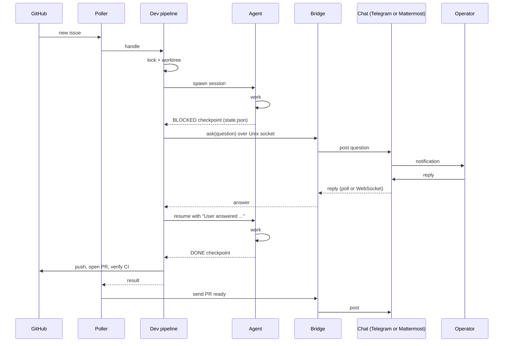

# Feedback loop

Every agent session that ctrlrelay spawns — Claude Code, OpenCode, Copilot, Codex or a plugin, per the
repo's `agent_type` — ends with a single JSON checkpoint file. The orchestrator
reads that file, decides what to do, and (if the session asked a question)
routes a human's answer back to a resumed session.

This page is the operator-level explanation of the protocol — what the file
looks like, how `BLOCKED` questions reach you, and how the answer becomes a
resume prompt.

## The checkpoint file

When ctrlrelay spawns the agent, it sets two environment variables in the child
process:

| Variable | Value |
|---|---|
| `CTRLRELAY_SESSION_ID` | UUID-tagged ID like `dev-your-org-your-app-42-a3f9cdfe`. |
| `CTRLRELAY_STATE_FILE` | Absolute path to the per-session JSON state file (typically `<worktree>/.ctrlrelay/state.json`). |

Before exiting, the agent writes one of three statuses to that path. The
schema is enforced by pydantic in
[`src/ctrlrelay/core/checkpoint.py`](https://github.com/AInvirion/ctrlrelay/blob/main/src/ctrlrelay/core/checkpoint.py).

### DONE

```json
{
  "version": "1",
  "status": "DONE",
  "session_id": "dev-your-org-your-app-42-a3f9cdfe",
  "timestamp": "2026-04-18T10:15:30Z",
  "summary": "PR opened",
  "outputs": {
    "pr_url": "https://github.com/your-org/your-app/pull/57",
    "pr_number": 57
  }
}
```

`outputs` is free-form. The dev pipeline expects `pr_url` and `pr_number` —
without those, the post-handoff PR-verification loop is skipped.

### BLOCKED_NEEDS_INPUT

```json
{
  "version": "1",
  "status": "BLOCKED_NEEDS_INPUT",
  "session_id": "dev-your-org-your-app-42-a3f9cdfe",
  "timestamp": "2026-04-18T10:18:02Z",
  "question": "Should I delete the deprecated /v1 endpoints, or only mark them as deprecated?",
  "question_context": { "issue": 42 }
}
```

`question` is required when `status` is `BLOCKED_NEEDS_INPUT`.
`question_context` is optional structured metadata — callers can pass anything
useful for the human (e.g. file paths the question refers to).

### FAILED

```json
{
  "version": "1",
  "status": "FAILED",
  "session_id": "dev-your-org-your-app-42-a3f9cdfe",
  "timestamp": "2026-04-18T10:21:55Z",
  "error": "git push failed: branch protection requires PR approval",
  "recoverable": true
}
```

`error` is required. `recoverable` defaults to `true` — set `false` to signal a
hard failure that retries should not attempt.

## End-to-end BLOCKED → answer → resume

Here is the full flow when an issue triggers a dev-pipeline run that ends up
asking the operator a question. The pipeline lives in
[`src/ctrlrelay/pipelines/dev.py`](https://github.com/AInvirion/ctrlrelay/blob/main/src/ctrlrelay/pipelines/dev.py);
the resume mechanism uses the agent's native session resume
(`claude --resume <id>` or `opencode run --session <id>`).



Step-by-step:

1. **Issue picked up.** The poller (`src/ctrlrelay/core/poller.py`) lists issues
   assigned to your GitHub username across configured repos and surfaces ones
   it has not seen before.
2. **Handler invoked.** The poller's CLI handler calls `run_dev_issue(...)` from
   `src/ctrlrelay/pipelines/dev.py`.
3. **Lock + worktree.** The pipeline acquires a per-repo lock from the SQLite
   state DB and creates a worktree on a new branch (default
   `fix/issue-{n}`, from `dev_branch_template`).
4. **Agent spawned.** The dispatcher in `src/ctrlrelay/core/dispatcher.py`
   runs the repo's backend inside the worktree, with `CTRLRELAY_SESSION_ID`
   and `CTRLRELAY_STATE_FILE` set: `ClaudeDispatcher` runs
   `claude -p <prompt> --output-format stream-json --verbose --dangerously-skip-permissions`;
   `OpenCodeDispatcher` runs `opencode run ... --format json --dangerously-skip-permissions`.
5–6. **Agent works, hits a question.** The agent writes a
   `BLOCKED_NEEDS_INPUT` checkpoint and exits.
7. **Pipeline reads checkpoint.** It sees `blocked=True` and a `question`.
8. **Bridge ask.** The pipeline calls `transport.ask(question)`, which sends an
   `ask` op over the Unix socket to the bridge.
9. **Bridge → chat.** The bridge posts the question into the configured
   Telegram chat or Mattermost channel, and remembers the post id.
10. **Push to operator.** The chat app notifies the operator on their phone or
    desktop client.
11. **Operator replies** with free-form text. If the question included
    `options`, Telegram shows them as a reply keyboard; Mattermost shows a
    numbered list to type from.
12. **Bridge receives the reply** — Telegram via its `getUpdates` long-poll,
    Mattermost via its WebSocket. A reply to the question (Telegram's reply
    gesture, `reply_to_message_id`; a Mattermost thread reply, `root_id`) is
    matched to that question exactly. A loose message is delivered only when
    exactly one question is outstanding; with several, the bridge refuses
    and lists what is outstanding rather than guess.
13. **Answer returned.** The bridge writes an `answer` op back to the original
    socket client. The pipeline's `transport.ask` call returns the answer text.
14. **Resume the agent.** `pipeline.resume(ctx, answer)` re-spawns the agent
    on its own session id with the prompt
    `"User answered: <text>\n\nContinue from where you left off."` followed
    by the checkpoint contract.
15–17. **Loop until terminal.** If the resumed session blocks again, steps
    8–14 repeat (capped at `DEFAULT_MAX_BLOCKED_ROUNDS`, currently 5). On
    `DONE`/`FAILED`, the loop exits.
18. **Publish and verify.** On `DONE` the agent has only committed; it has
    no GitHub access (#219). ctrlrelay pushes the run's branch, opens the PR
    from the title and description in the checkpoint, then verifies the PR
    is mergeable and CI is green. If not, it resumes the agent with the
    failed-job logs, pushes the fix itself and re-verifies (up to
    `DEFAULT_MAX_FIX_ATTEMPTS`, currently 3).
19. **Operator notified.** The poller pushes a final `✅ PR ready: <url>` (or
    `❌ Failed: …`) message via the bridge.

## Things to know

- **The bridge must be running** for the in-session answer route to work.
  If the transport call raises (no socket, timeout, etc.), the pipeline stops
  waiting but keeps the session `BLOCKED` and saves a `pending_resumes` row.
- **The in-session wait is `ask_timeout_seconds`** (default 900, set on the
  active transport block). It is not sized for an absent operator: an answer
  that arrives later still lands on the session's `pending_resumes` row and
  the scheduled sweeper drives the resume. An unanswered question stays
  routable for `question_ttl_seconds` (default 48 hours), then expires.
  When it was asked on an issue, the expiry is said there and the issue is
  labelled `ctrlrelay:unanswered` (when the label can be added): the run has stopped, and someone has to
  decide the question and start the issue again. Nothing removes the label.
- **A question is retired early only when everything it rests on is
  closed:** each `#N` it cites (in the question's repository), each
  `owner/repo#N` or link to an issue or pull request (in that
  repository), and the issue it was asked on. A question citing a
  reference whose repository cannot be told, such as `name#N` or
  `PR#N`, is never retired early and lasts its full TTL.
- **Maximum 5 BLOCKED rounds per session.** This bounds the chat noise from a
  pathological loop. After 5 rounds the pipeline gives up.
- **State is durable.** The checkpoint file and the SQLite state DB persist
  across orchestrator restarts, including outstanding questions.
- **`file_mock` is one-way.** The file-mock transport supports outbound
  notifications but does not implement the answer-on-reply round-trip used by
  the chat bridge. Use `file_mock` for tests only.

## Implementing your own BLOCKED in an agent session

If you write a custom prompt or skill that runs under ctrlrelay, signal a
question from inside the agent session by writing the checkpoint with
`python3`, so the question is JSON-escaped for you and the shell has
nothing to re-quote:

```bash
# Inside an agent session — both vars are set by the dispatcher.
python3 - "$CTRLRELAY_STATE_FILE" <<'CTRLRELAY_STATE'
import datetime, json, os, sys
text = r'''
Should I migrate the schema in this PR or split it?
'''.strip()
state = {
    "version": "1",
    "status": "BLOCKED_NEEDS_INPUT",
    "session_id": os.environ["CTRLRELAY_SESSION_ID"],
    "timestamp": datetime.datetime.now(datetime.timezone.utc).strftime(
        "%Y-%m-%dT%H:%M:%SZ"
    ),
    "question": text,
}
with open(sys.argv[1], "w") as f:
    json.dump(state, f)
CTRLRELAY_STATE
exit 0
```

The question may span lines and hold any quotes, but not three single
quotes in a row. The pipelines' prompts build the same shape with
`shell_checkpoint` in
[`src/ctrlrelay/core/checkpoint.py`](https://github.com/AInvirion/ctrlrelay/blob/main/src/ctrlrelay/core/checkpoint.py).
