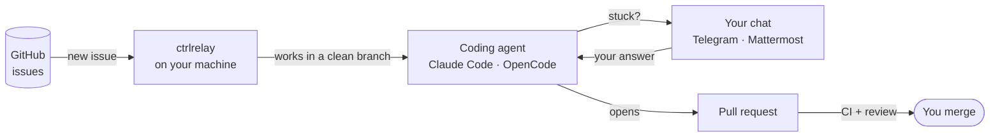

# Assign an issue. Get a reviewed pull request.
{: .fs-9 }

ctrlrelay turns the coding agent you already use into a teammate that works
your GitHub backlog in the background — and asks you on Telegram or
Mattermost only when it needs you.
{: .fs-6 .fw-300 }

[Get started]({{ '/getting-started/' | relative_url }}){: .btn .btn-primary .fs-5 .mb-4 .mb-md-0 .mr-2 }
[Set up chat]({{ '/bridge/' | relative_url }}){: .btn .fs-5 .mb-4 .mb-md-0 .mr-2 }
[View on GitHub](https://github.com/AInvirion/ctrlrelay){: .btn .fs-5 .mb-4 .mb-md-0 }

---

## How it works

1. **You assign an issue** to yourself, or add a label you pick.
2. **ctrlrelay starts the agent** in a fresh, isolated copy of the repo.
3. **If the agent has a question**, it lands in your chat. Your reply goes
   straight back to the same session — no restart, no lost context.
4. **A pull request opens.** ctrlrelay waits for CI, fixes what fails, and
   posts an independent review.
5. **You merge** — or ask for changes, like with any teammate.

## Why ctrlrelay

Coding agents are great when you sit and watch them. ctrlrelay is for the
work you don't want to sit and watch.

| You want… | ctrlrelay gives you… |
|---|---|
| No new tool for the team | Work starts from a GitHub issue and ends as a normal pull request. |
| Your code to stay with you | It runs on your laptop or server. No hosted service, no extra platform fee on top of your agent subscription. |
| Fewer wrong guesses | When the agent is stuck it asks you in chat, and your answer resumes the same session. |
| Changes you can trust | One isolated copy of the repo per issue, one job per repo at a time, an optional Linux sandbox that hides your secrets. |
| Pull requests that are ready to read | CI is waited on, failing checks get fixed, and every PR carries a review comment. |
| Freedom to choose the model | Claude Code, or OpenCode with a local model — chosen per repo. |
| Room to grow | Start on one machine; add more later and they split the work without collisions. |
| To see what runs on your machine | Open source, Apache 2.0. |

## What's included

- **Dev pipeline** — issue to pull request, end to end.
- **Task pipeline** — issues with a task label get a written report instead of a pull request.
- **Chat bridge** — [Telegram or Mattermost]({{ '/bridge/' | relative_url }}),
  one at a time.
- **Automatic review** — a second-opinion review comment on every agent PR.
- **Daily security sweep** — Dependabot alerts and PRs, every morning.
- **Status page** — what each agent is doing, what is waiting, what needs you.
- **Several machines** — [one account, many machines]({{ '/adding-a-machine/' | relative_url }}),
  one chat.
- **Personalization sync** — [your agent setup on every machine]({{ '/personalization/' | relative_url }}).

## Where to go next

**Use it**

- [Getting started]({{ '/getting-started/' | relative_url }}) — prerequisites, install, first run.
- [Chat bridge]({{ '/bridge/' | relative_url }}) — connect Telegram or Mattermost.
- [Configuration]({{ '/configuration/' | relative_url }}) — every setting, with defaults.
- [Feedback loop]({{ '/feedback-loop/' | relative_url }}) — how a question reaches you and your answer gets back.
- [Operations]({{ '/operations/' | relative_url }}) — background services, status page, logs.
- [Adding a machine]({{ '/adding-a-machine/' | relative_url }}) — share the work across machines.
- [CLI reference]({{ '/cli/' | relative_url }}) — every command and flag.

**Build on it**

- [Architecture]({{ '/architecture/' | relative_url }}) — how the pieces fit.
- [Development]({{ '/development/' | relative_url }}) — local setup, tests, contributing.

Using an AI assistant? Point it at [`llms.txt`]({{ '/llms.txt' | relative_url }}).
